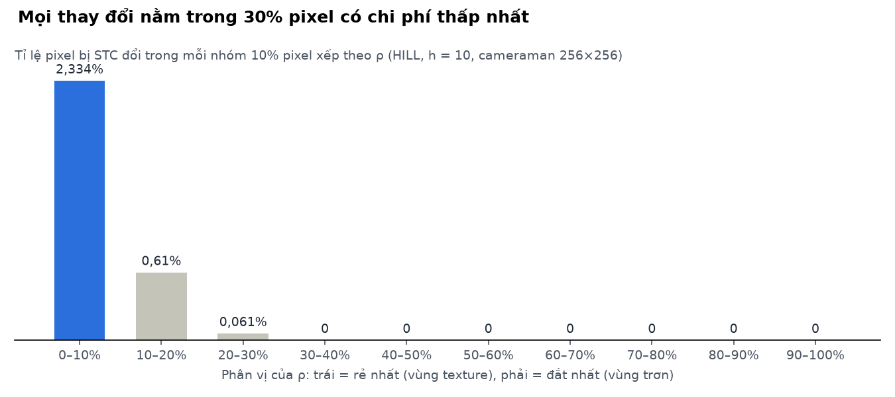

# Giấu tin thích nghi trên ảnh xám bằng HILL/WOW và Syndrome-Trellis Codes: mô tả thuật toán

*Cập nhật: 10/11/2026*

## 1. Đặt vấn đề và mô hình tối thiểu hoá méo

Hệ thống giấu một thông điệp vào ảnh xám 8-bit bằng cách đổi một số ít pixel đi ±1, đặt các thay đổi vào vùng texture nơi chúng khó bị phát hiện nhất. Bài toán được đặt theo khung *tối thiểu hoá méo cộng tính* (additive distortion) của Filler, Judas và Fridrich: mỗi pixel có một chi phí thay đổi, và bộ mã hoá tìm cách nhúng có tổng chi phí nhỏ nhất.

**Ký hiệu.** Ảnh cover X = (xᵢⱼ) kích thước H×W, N = H·W pixel, xᵢⱼ ∈ {0, …, 255}. Ảnh stego Y = (yᵢⱼ) với |yᵢⱼ − xᵢⱼ| ≤ 1. Thông điệp (đã mã hoá) là m ∈ {0,1}^M. Chi phí thay đổi pixel (i,j) là ρᵢⱼ ≥ 0.

**Bài toán người gửi giới hạn payload (payload-limited sender).** Với x = LSB(X) và y = LSB(Y) là hai vector bit dài n, tìm:

```math
y^{*} = \arg\min_{y \in \{0,1\}^{n}} \; D(x, y) = \sum_{k=1}^{n} \rho_k \, [x_k \neq y_k] \quad \text{với ràng buộc} \quad H y = m \pmod 2
```

Trong đó H ∈ {0,1}^(M×n) là ma trận kiểm tra chẵn lẻ chung giữa hai bên. Người nhận chỉ cần tính syndrome m = H·y, không cần biết ρ hay ảnh gốc. Đây là lý do chi phí có thể phụ thuộc tuỳ ý vào nội dung ảnh mà việc trích xuất vẫn đúng.

Thuật toán gồm bảy bước: ảnh gốc → đặc trưng cục bộ → bản đồ độ texture Q → chi phí ρ → mã hoá STC → ảnh stego (±1) → trích xuất. Các mục 2–6 mô tả lần lượt từng bước; mục 7 trình bày kết quả đo trên chương trình cài đặt.

## 2. Trích xuất đặc trưng và bản đồ Q

Bản đồ Q ∈ [0,1] đo độ “khó dự đoán” của từng pixel từ lân cận: Q gần 1 ở vùng texture, gần 0 ở vùng trơn. Cơ sở là các bộ phân tích ảnh (steganalysis) hiện đại làm việc trên phần dư high-pass; một thay đổi ±1 ở nơi phần dư vốn lớn sẽ bị nhiễu tự nhiên che đi.

Chương trình tính bốn đặc trưng (tích chập với biên phản xạ đối xứng):

| Đặc trưng | Công thức | Vai trò |
| --- | --- | --- |
| Phần dư KB | \|X ⋆ KB\|, KB = [[−1,2,−1],[2,−4,2],[−1,2,−1]] | Bộ lọc Ker–Böhme, bước đầu của HILL |
| Độ lệch chuẩn cục bộ | σ = √(E[X²] − E[X]²) trên cửa sổ 5×5 | Trực quan, dễ giải thích |
| Gradient | \|∇X\| = √(Sₓ² + Sᵧ²), bộ lọc Sobel | Phát hiện cạnh |
| Phần dư wavelet | Σₖ \|X ⋆ Kₖ\|, k ∈ {LH, HL, HH}, Daubechies-8 | Ngân hàng lọc của WOW / S-UNIWARD |

Bộ lọc định hướng được tạo từ bộ lọc thông thấp Daubechies-8 h (16 hệ số) và bộ lọc thông cao g[n] = (−1)ⁿ·h[15−n]: K_LH = h·gᵀ, K_HL = g·hᵀ, K_HH = g·gᵀ. Hệ số h được tính bằng phân tích phổ và đã kiểm tra tính trực chuẩn (Σh² = 1, h[0] ≈ 0,05442).

**Tổng hợp thành Q.** Với HILL, Q theo lược đồ high-pass → trị tuyệt đối → low-pass, rồi chuẩn hoá bền vững theo phân vị 99:

```math
\xi = |X \star KB| \star L_1, \qquad Q = \operatorname{clip}\!\left( \frac{\xi}{P_{99}(\xi)},\; 0,\; 1 \right)
```

L₁ là bộ lọc trung bình 3×3. Với biến thể WOW, mỗi hướng cho ξₖ = |X ⋆ Kₖ| ⋆ |Kₖ|, và ba hướng được gộp theo trung bình điều hoà (Hölder, p = −1):

```math
\xi_{\mathrm{WOW}} = \left( \sum_{k \in \{LH, HL, HH\}} \xi_k^{-1} \right)^{-1}
```

Cách gộp này khiến một pixel chỉ được coi là texture khi nó phức tạp theo cả ba hướng. Một cạnh thẳng, chỉ phức tạp theo một hướng, vẫn có Q thấp vì nó dễ dự đoán dọc theo cạnh. Phương án đối chứng “đồng đều” đặt Q = 0,5 cho mọi pixel. Độ lệch chuẩn và gradient không tham gia vào Q; chúng được hiển thị để giải thích trực quan.

## 3. Hàm chi phí ρ

Chi phí ρ tỉ lệ nghịch với Q: pixel texture rẻ, pixel trơn đắt. Chương trình hỗ trợ ba hàm chi phí, cùng dùng ε = 10⁻³ (nên ρ bị chặn trên khoảng 1/ε = 1000).

**HILL** (Li và cộng sự, 2014). Sau khi lấy nghịch đảo, chi phí được làm trơn thêm bằng bộ lọc trung bình L₂ kích thước 15×15:

```math
\rho^{\mathrm{HILL}} = L_2 \star \frac{1}{Q + \varepsilon}
```

Bước L₂ “lan” chi phí cao của vùng trơn sang các pixel lân cận. Kết quả là thay đổi được gom vào các vùng texture lớn, liền khối, thay vì rải vào những điểm texture nhỏ nằm giữa vùng trơn. Do Q là ξ chia cho một hằng số, ρ trên đây trùng với công thức gốc của HILL (sai khác hằng số và cách chọn ε).

**WOW-like** (Holub và Fridrich, 2012). Chi phí là tổng nghịch đảo của ba độ phức tạp định hướng, tức ρ = Σₖ ξₖ⁻¹ = 1/ξ_WOW, nên sau chuẩn hoá ρ^WOW = 1/(Q + ε). Khác với WOW gốc, chương trình tính ξₖ bằng tích chập trên ảnh cover một lần, không tính lại phần dư sau khi thử thay đổi từng pixel; vì vậy gọi là “WOW-like”.

**Đồng đều** (đối chứng). ρ = 1 cho mọi pixel. Khi đó STC chỉ còn tối thiểu hoá số pixel bị đổi và không quan tâm vị trí.

**Hướng thay đổi bị cấm.** Mỗi pixel có hai chi phí theo hướng, ρ⁺ cho +1 và ρ⁻ cho −1. Hướng làm pixel tràn khỏi [0,255] có chi phí vô hạn:

```math
\rho^{+}_{ij} = \begin{cases} \infty & x_{ij} = 255 \\ \rho_{ij} & \text{còn lại} \end{cases} \qquad \rho^{-}_{ij} = \begin{cases} \infty & x_{ij} = 0 \\ \rho_{ij} & \text{còn lại} \end{cases} \qquad \rho^{\mathrm{bin}}_{ij} = \min(\rho^{+}_{ij}, \rho^{-}_{ij})
```

STC làm việc trên mặt phẳng LSB nên chỉ cần chi phí nhị phân ρ^bin của việc đảo LSB. Với ảnh 8-bit luôn còn ít nhất một hướng hợp lệ, nên ρ^bin luôn hữu hạn; việc chọn hướng hợp lệ được xử lý ở bước nhúng ±1 (mục 6). Trên ảnh cameraman 256×256 với HILL, ρ trải từ 1,7 đến 304 (trung vị 17,3), và có 122 hướng bị cấm.

## 4. Syndrome-Trellis Codes

STC giải chính xác bài toán ở mục 1 cho một lớp ma trận H có cấu trúc dải băng, bằng thuật toán Viterbi với độ phức tạp O(n·2^h). Chương trình tự cài đặt toàn bộ, không dùng thư viện có sẵn.

### 4.1. Cấu trúc ma trận H

H được ghép từ một ma trận con Ĥ kích thước h×w. Khối i (i = 1, …, M) gồm wᵢ cột liên tiếp của H, chứa Ĥ đặt tại các hàng i, i+1, …, i+h−1. Khối sau dịch xuống đúng một hàng so với khối trước, và ở h−1 khối cuối Ĥ bị cắt các hàng vượt quá M. Nhờ vậy mỗi bit yₖ chỉ ảnh hưởng tới h bit syndrome liên tiếp.

- **Tham số h** (chiều cao Ĥ, 7–10 trong giao diện) quyết định số trạng thái 2^h của trellis: h lớn hơn cho hiệu suất nhúng gần giới hạn lý thuyết hơn nhưng chậm hơn.
- **Sinh Ĥ:** các cột là số ngẫu nhiên h-bit từ PRNG có seed suy ra từ khoá; hàng đầu và hàng cuối được ép bằng 1. Hàng đầu toàn 1 đảm bảo bài toán luôn có nghiệm (mỗi khối có thể điều khiển bit mᵢ của chính nó).
- **Độ rộng khối thay đổi:** thay vì w cố định, chương trình dùng wᵢ = ⌊(i+1)n/M⌋ − ⌊in/M⌋, nên Σwᵢ = n với mọi tỉ lệ nhúng α = M/n. Mọi pixel trong vùng đều tham gia syndrome, vì vậy đảo bất kỳ LSB nào cũng làm sai ít nhất một bit thông điệp.

### 4.2. Trellis

Trạng thái của trellis là h bit syndrome “đang mở”, bit 0 ứng với hàng hiện tại i. Biểu diễn mỗi cột Ĥ là một số nguyên h-bit cⱼ; từ trạng thái s, mỗi bit yₖ cho hai cạnh:

- **yₖ = 0:** trạng thái giữ nguyên s, chi phí ρₖ nếu xₖ = 1, ngược lại 0.
- **yₖ = 1:** trạng thái thành s ⊕ cⱼ, chi phí ρₖ nếu xₖ = 0, ngược lại 0.

Hết khối i, bit 0 của trạng thái phải bằng mᵢ. Chỉ các trạng thái thỏa điều kiện này được giữ, rồi trạng thái dịch phải một bit (s → s ≫ 1) để chuyển sang hàng i+1. Trạng thái bắt đầu và kết thúc đều là 0. Mỗi đường đi từ đầu đến cuối ứng với đúng một vector y thỏa H·y = m, và độ dài đường đi bằng D(x, y).

### 4.3. Thuật toán Viterbi

```text
Input : x ∈ {0,1}^n, ρ ∈ R+^n, m ∈ {0,1}^M, h, cột Ĥ c_1..c_wmax, độ rộng w_1..w_M
Output: y với H·y = m và Σ ρ_k [x_k ≠ y_k] nhỏ nhất

W[0] ← 0;  W[s] ← ∞ với s ≠ 0          // 2^h trạng thái
k ← 1
for i = 1..M:
    mask ← 2^min(h, M−i+1) − 1               // cắt Ĥ ở các khối cuối
    for j = 1..w_i:
        c ← c_j AND mask
        for mọi s:
            w0 ← W[s]     + ρ_k·[x_k = 1]       // y_k = 0
            w1 ← W[s ⊕ c] + ρ_k·[x_k = 0]       // y_k = 1
            W'[s] ← min(w0, w1);  P[k][s] ← [w1 < w0]
        W ← W';  k ← k + 1
    // kiểm tra và đẩy bit m_i ra
    for s < 2^(h−1):  W'[s] ← W[2s + m_i]
    for s ≥ 2^(h−1):  W'[s] ← ∞
    W ← W'

// truy vết ngược
s ← 0;  k ← n
for i = M..1:
    s ← 2s + m_i
    for j = w_i..1:
        y_k ← P[k][s];  if y_k = 1: s ← s ⊕ (c_j AND mask_i)
        k ← k − 1
return y   (chi phí tối ưu = W[0])
```

Bảng truy vết P cần n·2^h bit; chương trình nén mỗi hàng bằng packbits nên với n = 64 512 và h = 10 chỉ chiếm khoảng 8 MB. Vòng lặp theo trạng thái được vector hoá bằng numpy; nhúng ảnh 256×256 mất 0,4–0,9 giây. Khi hai cạnh có cùng chi phí, thuật toán chọn yₖ = 0.

### 4.4. Kiểm chứng tính đúng

Bốn tính chất được kiểm tra tự động bằng pytest:

1. H·y = m với 120 thông điệp ngẫu nhiên, h ∈ {1, 2, 3, 5, 7, 8, 9, 10}, n từ 64 đến 3000 và α từ 0,02 đến 1.
2. Chi phí Viterbi bằng Σρ[x ≠ y] tính lại từ y.
3. Tối ưu toàn cục: trên 30 bài toán n = 12, chi phí Viterbi bằng chi phí nhỏ nhất tìm được bằng vét cạn 2¹² = 4096 vector.
4. Phiên bản Viterbi viết bằng vòng lặp thuần (dùng để vẽ trellis minh hoạ) cho cùng y và cùng chi phí với bản vector hoá.

Ví dụ minh hoạ trên giao diện dùng 12 pixel thật của ảnh cameraman, h = 3 và 3 bit thông điệp: Viterbi đổi 2 LSB với chi phí 7,5999, đúng bằng kết quả vét cạn.

## 5. Giao thức nhúng

Giao thức được thiết kế để người nhận chỉ cần file stego và khoá. Mọi tham số khác (h, độ dài, độ rộng khối) được nhúng trong ảnh hoặc suy ra từ khoá.

### 5.1. Header và checksum

Thông điệp văn bản được mã hoá UTF-8 thành dãy byte, rồi được gắn một header 88 bit (big-endian):

| Trường | Số bit | Giá trị |
| --- | --- | --- |
| magic | 16 | 0x5354 (“ST”) |
| h | 8 | tham số STC của vùng payload |
| length | 32 | số byte của thông điệp |
| crc32 | 32 | CRC32 của thông điệp (bản rõ) |

Magic giúp phát hiện sớm trường hợp sai khoá. CRC32 phát hiện mọi sai lệch của payload, bao gồm ảnh bị nén mất mát hoặc bị sửa.

### 5.2. Mã hoá và hoán vị theo khoá

- **Mã hoá dòng:** header và payload được XOR với dòng khoá SHA-256(khoá ‖ nhãn ‖ bộ đếm), mỗi phần một nhãn riêng. Sau khi mã hoá, m là dãy bit giống ngẫu nhiên, đúng với giả thiết của STC.
- **Hoán vị pixel:** thứ tự N pixel được xáo bằng PRNG (numpy PCG64) có seed = 64 bit đầu của SHA-256(khoá ‖ “perm”). Mỗi khối STC vì vậy gồm các pixel rải khắp ảnh, nên khối nào cũng có pixel rẻ để lựa chọn.
- **Ma trận Ĥ:** sinh từ seed SHA-256(khoá ‖ nhãn vùng ‖ h).

### 5.3. Hai vùng STC

Người nhận cần biết M và h để dựng lại H, nhưng hai giá trị này lại nằm trong header. Chương trình giải vòng phụ thuộc này bằng hai vùng độc lập trên dãy pixel đã hoán vị:

| Vùng | Pixel (ảnh 256×256) | Số bit M | h | Người nhận biết M, h từ đâu |
| --- | --- | --- | --- | --- |
| Header | 1024 pixel đầu | 88 | 7 | Cố định trong giao thức |
| Payload | 64 512 pixel còn lại | 8 × length | từ header | Đọc từ header đã giải mã |

Mỗi vùng chạy STC riêng với chi phí của chính các pixel trong vùng đó. Tổng chi phí nhúng là tổng chi phí Viterbi của hai vùng.

### 5.4. Dung lượng

Tỉ lệ nhúng vùng payload được giới hạn ở α ≤ 0,5 bit/pixel (wᵢ ≥ 2):

```math
C_{\mathrm{byte}} = \left\lfloor \frac{\lfloor 0{,}5 \cdot (N - 1024) \rfloor}{8} \right\rfloor
```

Với ảnh 256×256, C = 4032 byte. Thông điệp vượt dung lượng bị từ chối kèm thông báo lỗi trước khi nhúng. Giới hạn này là lựa chọn thực dụng: ở tỉ lệ cao hơn, số pixel bị đổi tăng nhanh và ảnh dễ bị steganalysis phát hiện.

## 6. Nhúng ±1 và trích xuất

STC chỉ quyết định pixel nào phải đảo LSB. Việc đảo được thực hiện bằng LSB matching ±1, vì cộng hay trừ 1 đều đảo LSB.

### 6.1. Thuật toán nhúng

```text
Input : cover X (H×W, uint8), thông điệp text, khoá K, h, hàm chi phí
Output: stego Y, danh sách pixel thay đổi

1. Nếu |UTF8(text)| > C: báo lỗi dung lượng, dừng
2. Tính Q, ρ, ρ⁺, ρ⁻ từ X                                    (mục 2–3)
3. hdr ← Enc_K(magic ‖ h ‖ length ‖ CRC32);  pay ← Enc_K(UTF8(text))
4. π ← Perm_K(N);  x ← LSB(X[π]);  r ← ρ_bin[π]
5. y[1..1024]   ← STC(x[1..1024],  r[1..1024],  hdr, h = 7)
   y[1025..N]   ← STC(x[1025..N],   r[1025..N],   pay, h)
6. for mỗi k với y_k ≠ x_k:                                   // bản đồ thay đổi lấy trực tiếp từ STC
       p ← π(k)
       if X[p] = 0:   δ ← +1
       elif X[p] = 255: δ ← −1
       else:          δ ← ±1 ngẫu nhiên theo PRNG_K
       Y[p] ← X[p] + δ
7. Lưu Y dạng PNG (nén không mất mát)
```

Bước 6 đảm bảo |Y − X| ≤ 1 và Y ∈ [0,255]. Vì ρ⁺ = ρ⁻ ở mọi pixel không bão hoà, chọn dấu ngẫu nhiên không làm tăng chi phí và giữ histogram cân bằng hơn so với thay thế LSB (LSB replacement).

### 6.2. Thuật toán trích xuất

Trích xuất chỉ là một phép nhân ma trận trên GF(2), không cần cover, ρ hay bất kỳ trạng thái nào của phiên nhúng:

```text
Input : file ảnh, khoá K
Output: thông điệp hoặc “không khôi phục được” kèm lý do

1. Đọc file → ảnh xám Y (không resize)
2. π ← Perm_K(N);  y ← LSB(Y[π])
3. hdr ← Dec_K(H_hdr · y[1..1024]);  tách magic, h, length, crc
4. Nếu h ∉ [1,14] hoặc length > C: thất bại (header hỏng)
5. pay ← Dec_K(H_pay(h, 8·length) · y[1025..N])
6. Nếu CRC32(pay) ≠ crc hoặc magic ≠ 0x5354: thất bại (checksum sai)
7. Giải mã UTF-8 → thông điệp
```

Phép H·y được tính vector hoá: với mỗi hàng con r = 0..h−1, cộng dồn bit (cⱼ ≫ r) AND yₖ vào hàng syndrome (khối của k) + r, rồi lấy mod 2. Toàn bộ trích xuất được bọc trong xử lý ngoại lệ: dữ liệu rác (sai khoá, file không phải ảnh, ảnh quá nhỏ) luôn trả về trạng thái thất bại kèm lý do, không làm treo chương trình.

### 6.3. Hành vi khi ảnh bị thay đổi

| Tình huống | Cơ chế phát hiện | Kết quả đo được |
| --- | --- | --- |
| Sai khoá | Hoán vị, Ĥ và dòng khoá đều khác nên header là rác | Magic sai (ví dụ 0x347B), h không hợp lệ |
| Ảnh chuyển sang JPEG (q = 75, 95, 100) | Nén mất mát đổi hàng nghìn LSB | Magic hoặc checksum sai |
| Sửa 1 pixel ±1 | Mọi pixel đều nằm trong một khối STC; hàng đầu Ĥ toàn 1 nên bit mᵢ của khối đó bị đảo | Checksum sai ở cả 33/33 vị trí thử |

Ngoại lệ duy nhất: khi thông điệp rỗng, vùng payload không mang dữ liệu, nên sửa một pixel ở vùng đó không bị phát hiện.

## 7. Kết quả thực nghiệm

Với cùng thông điệp, HILL + STC có tổng chi phí thấp hơn LSB tuần tự khoảng 105 lần, và 98% thay đổi nằm ở 20% pixel rẻ nhất. Thí nghiệm dùng ảnh cameraman (scikit-image) resize về 256×256 (N = 65 536), thông điệp tiếng Việt 142 byte (1224 bit kể cả header, 0,0187 bpp), h = 10. Thời gian đo trên máy cá nhân, Python 3.11.

### 7.1. So sánh các phương pháp

Cột Σρ tính theo cùng chi phí HILL cho mọi phương pháp, để so sánh được với nhau.

| Phương pháp | Pixel đổi | Σρ (HILL) | % thay đổi ở 20% ρ rẻ nhất | Hiệu suất (bit/thay đổi) | PSNR (dB) | SSIM |
| --- | --- | --- | --- | --- | --- | --- |
| HILL + STC | 197 | 565 | 98,0 | 6,21 | 73,35 | 0,999994 |
| WOW-like + STC | 208 | 1 086 | 56,7 | 5,88 | 73,11 | 0,999997 |
| Đồng đều + STC | 148 | 3 863 | 25,0 | 8,27 | 74,59 | 0,999983 |
| LSB tuần tự | 602 | 59 138 | 0,0 | 2,03 | 68,50 | 0,999937 |

Chi phí đồng đều cho ít thay đổi nhất (STC tối thiểu hoá đúng số thay đổi), nhưng rải chúng khắp ảnh. HILL chấp nhận thêm khoảng 33% thay đổi để đưa chúng vào vùng texture. PSNR và SSIM gần như ngang nhau giữa các phương pháp, nên chúng không phản ánh độ an toàn trước steganalysis; chỉ số có ý nghĩa là vị trí thay đổi.

### 7.2. Thay đổi theo chi phí



*Nguồn: chương trình demo · cameraman 256×256, thông điệp 142 byte, 10 nhóm phân vị ρ.*

Xác suất một pixel bị đổi giảm đơn điệu theo ρ và bằng 0 từ phân vị 30 trở đi. Vùng bầu trời (khối 32×32 có Q trung bình 0,016, ρ trung bình 88,5) không có pixel nào bị đổi; vùng cỏ (Q = 0,508, ρ = 2,49) có 38 pixel bị đổi (3,7%).

### 7.3. Ảnh hưởng của payload và h

| Payload (byte) | bpp | Pixel đổi, h = 7 | Pixel đổi, h = 10 | Hiệu suất, h = 10 | PSNR, h = 10 (dB) | Thời gian, h = 10 (s) |
| --- | --- | --- | --- | --- | --- | --- |
| 64 | 0,009 | 102 | 89 | 6,74 | 76,8 | 0,66 |
| 256 | 0,033 | 417 | 382 | 5,59 | 70,5 | 0,66 |
| 1 024 | 0,126 | 2 094 | 1 979 | 4,18 | 63,3 | 0,69 |
| 2 048 | 0,251 | 5 079 | 4 868 | 3,38 | 59,4 | 0,73 |
| 4 032 (tối đa) | 0,494 | 12 275 | 11 670 | 2,77 | 55,6 | 0,93 |

Tăng h từ 7 lên 10 giảm số thay đổi 4–13% và tăng thời gian khoảng 1,6 lần. Hiệu suất nhúng giảm khi payload tăng, đúng xu hướng lý thuyết của mã hoá ma trận. Mọi trường hợp đều trích xuất đúng.

### 7.4. Kiểm thử tự động

Bộ pytest gồm 40 test, tất cả đạt (khoảng 25 giây): tính đúng và tối ưu của STC (mục 4.4); nhúng → lưu PNG → đọc lại → trích xuất với tiếng Việt có dấu, emoji, thông điệp rỗng và thông điệp đúng bằng dung lượng; số pixel trong bảng thay đổi bằng số pixel khác nhau trên file, |Y − X| ≤ 1, Y ∈ [0,255]; chi phí STC ≤ LSB tuần tự; các trường hợp âm ở mục 6.3; và lỗi vượt dung lượng.

## 8. Hạn chế và hướng phát triển

Cài đặt hiện tại chứng minh đúng cơ chế nhúng, nhưng chưa đánh giá độ an toàn trước steganalysis. Các hạn chế chính:

- **Chưa đo độ an toàn.** Chưa chạy bộ phân tích SRM + ensemble classifier hay mạng CNN (ví dụ SRNet) trên tập ảnh chuẩn như BOSSbase để đo sai số phát hiện P_E. Đây là bước cần thiết trước khi so sánh HILL với WOW một cách định lượng.
- **WOW-like là phiên bản rút gọn.** Chi phí tính một lần trên cover, không tính lại phần dư sau khi thử thay đổi từng pixel như WOW gốc.
- **STC nhị phân.** Chương trình dùng STC trên mặt phẳng LSB với ρ = min(ρ⁺, ρ⁻). Mã hoá ba giá trị (ternary, {−1, 0, +1}) bằng STC nhiều lớp sẽ cho hiệu suất cao hơn khi ρ⁺ ≠ ρ⁻.
- **Không bền với xử lý ảnh.** Bất kỳ phép nén mất mát hay chỉnh sửa nào đều phá huỷ thông điệp; CRC32 chỉ phát hiện, không sửa lỗi. Ứng dụng cần độ bền phải thêm mã sửa sai hoặc nhúng trong miền DCT (J-UNIWARD).
- **Mã hoá đơn giản.** Dòng khoá SHA-256 chế độ bộ đếm, không có nonce và không xác thực. Triển khai thực tế nên dùng AES-GCM hoặc ChaCha20-Poly1305 với khoá dẫn xuất qua KDF.
- **Giới hạn kích thước.** Bảng truy vết tăng theo n·2^h; ảnh lớn hơn 512×512 với h = 10 cần xử lý theo từng đoạn.

Hướng phát triển gần nhất: đánh giá P_E trên BOSSbase với các tỉ lệ 0,1–0,5 bpp, rồi cài đặt chi phí S-UNIWARD và STC ba giá trị để so sánh.

## Tài liệu tham khảo

1. T. Filler, J. Judas, J. Fridrich. Minimizing Additive Distortion in Steganography Using Syndrome-Trellis Codes. IEEE Transactions on Information Forensics and Security, 6(3), 2011, tr. 920–935.
2. B. Li, M. Wang, J. Huang, X. Li. A New Cost Function for Spatial Image Steganography. IEEE International Conference on Image Processing (ICIP), 2014.
3. V. Holub, J. Fridrich. Designing Steganographic Distortion Using Directional Filters. IEEE Workshop on Information Forensics and Security (WIFS), 2012.
4. V. Holub, J. Fridrich, T. Denemark. Universal Distortion Function for Steganography in an Arbitrary Domain. EURASIP Journal on Information Security, 2014.
5. A. D. Ker, R. Böhme. Revisiting Weighted Stego-Image Steganalysis. Security, Forensics, Steganography, and Watermarking of Multimedia Contents X, Proc. SPIE 6819, 2008.

Thông tin xuất bản được ghi theo trí nhớ, chưa đối chiếu với nguồn gốc; cần kiểm tra lại số trang và năm trước khi đưa vào luận văn.
